<div align="center">

# Any3d — AI 3D Scene Studio on Your Machine

**Describe complex places in natural language — from bustling metropolis cities and deep-water container docks to orbital rocket launchpads and automated agritech farms. Watch them build in real-time. Keep editing them conversationally. Export one self-contained HTML file that runs anywhere offline.**

[](https://react.dev/)
[](https://vitejs.dev/)
[](https://threejs.org/)
[](https://ollama.com/)
[](LICENSE)
[](https://github.com/Dostam-07/Any3d/actions/workflows/ci.yml)
[](https://github.com/Dostam-07/Any3d/actions/workflows/showcase.yml)

[Quick Start](#quick-start) • [Complex Scene Gallery](#complex-scene-gallery--prompt-cookbook) • [Three Render Engines](#three-render-engines) • [Web Presentation Sizes](#web-presentation-sizes-hero-vs-card) • [Inside-Out Showcase](#inside-out-showcase-hero-and-card) • [Atmosphere & Look](#atmosphere--lighting-scrubber) • [Visual Research](#web-visual-grounding) • [Exports](#export-suite) • [Docs](#documentation)

</div>

<br />

<p align="center">
  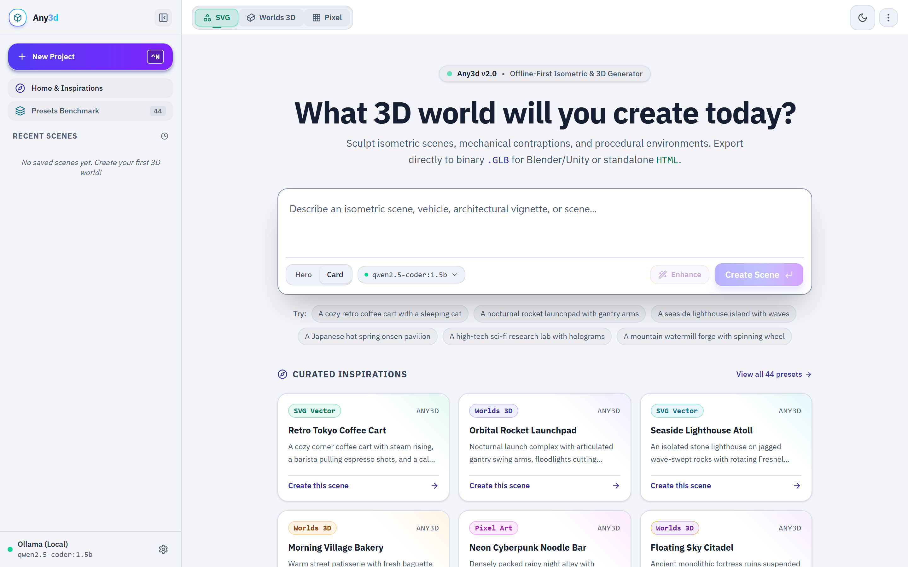
</p>

Any3d is an open-source, local-first **text-to-3D scene creative studio**. It transforms descriptive prompts into interactive, animated, miniature 3D worlds. Whether you need a dense cyberpunk city grid, an industrial shipping dock with operating gantry cranes, a heavy-lift rocket launch facility, or an automated crop farm with GPS combines, Any3d generates complete procedural geometry, lighting, materials, and motion loops.

Every scene is fully editable in real-time chat, responsive across desktops and phones, grounded in real-world visual references, and exports into a single standalone HTML file with zero runtime dependencies.

---

## Highlights

| Feature | Description |
|---|---|
| **Complex Prompt to 3D Scene** | Natural language compiles directly into intricate multi-object dioramas — skyscrapers, cargo cranes, launch gantries, articulated vehicles, and synchronized animation loops. |
| **Conversational Editing** | Follow-up prompts refine *the current live scene*: "add an elevated monorail between the towers", "make the rocket engines vent vapor", "add a combine harvester to the crop field". |
| **Three Render Engines** | Choose from **SVG Vector** (clean architectural lines), **Three.js Worlds 3D** (ambient-occluded WebGL dioramas), and **Pixel Art** (nostalgic 320×240 software rasterizer). |
| **Web Presentation Modes** | Calibrated output formats: **Hero (16:9)** for wide landing page banners, and **Card (4:3)** for compact website UI components. |
| **Authentic Visual Grounding** | Automated background photographic research via Wikipedia Commons extracts authentic real-world engineering details, materials, and architectural scales — never mock or fake data. |
| **Live Atmosphere Scrubber** | Real-time lighting control (Dawn, Noon, Dusk, Night, Golden Hour, Blue Hour) and dynamic weather (Clear, Rain, Snow). |
| **AnyStack 3D Arcade** | Integrated 3D tower-stacking physics minigame built directly into the studio to enjoy while scenes build. |
| **Offline-First & Privacy** | Run 100% locally with **Ollama** on your GPU/CPU, or connect **Google Gemini** for high-speed cloud generation. |
| **Deterministic Validation** | Multi-point automated inspection: structural clock purity, ground pedestal bounds, pointer hover/picking hooks, and prompt fidelity scoring. |
| **One-File Offline Export** | Download a single `.html` file with the runtime inlined — open it on an airplane with no internet connection. |

---

## Workspace Layout

Starting a project opens its dedicated studio workspace (`#/project/<id>`) pairing the conversational chat assistant on the left with the interactive live 3D viewport on the right.

<p align="center">
  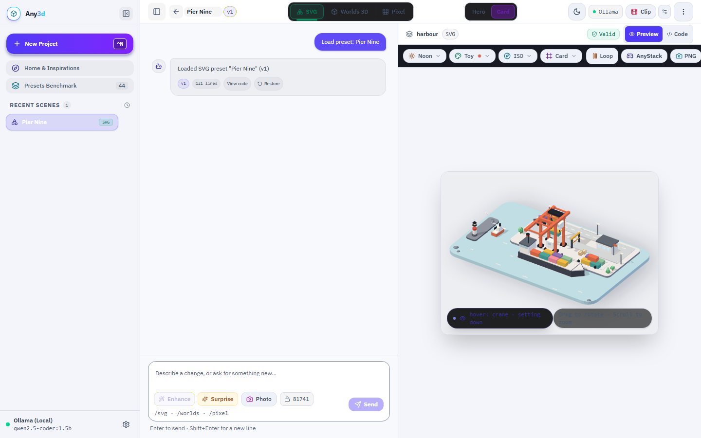
</p>

---

## Complex Scene Gallery & Prompt Cookbook

Any3d is built to handle rich, multi-layered environments with dozens of interacting elements. Here are ready-to-build scenes and prompts across complex industrial, urban, aerospace, and agricultural settings:

### 🚢 Deep-Water Industrial Container Dock & Shipping Harbour

<p align="center">
  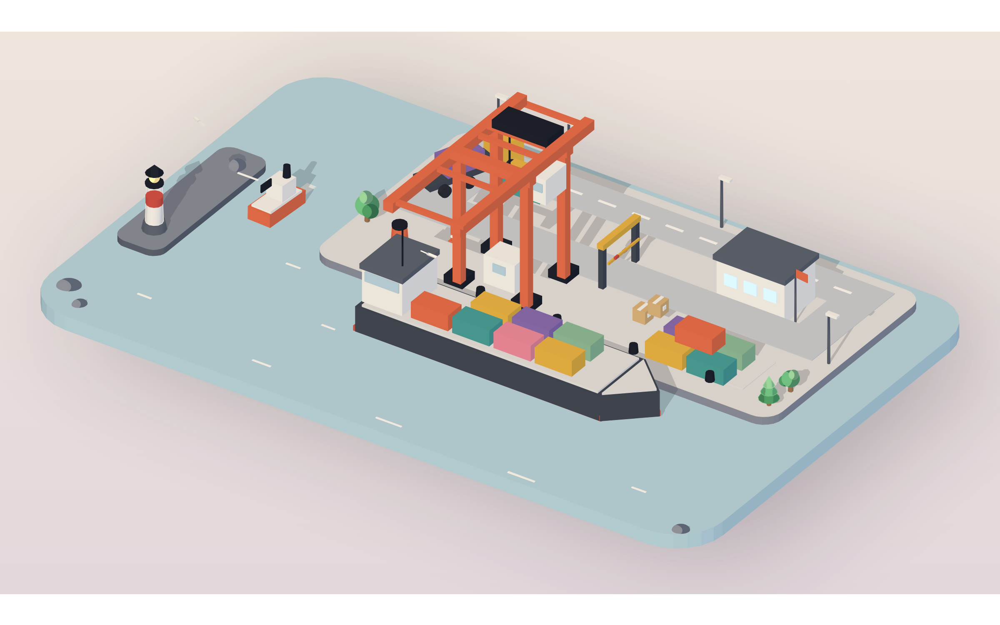
</p>

```text
A sprawling deep-water maritime shipping container terminal: a massive container freighter docked along a concrete quay, rail-mounted gantry cranes actively lifting colored shipping containers, transport trucks queueing in striped transit lanes, stacks of modular cargo crates, a harbor tugboat with water spray escort, and animated ocean waves with channel buoys.
```
- **Key Props**: Container freighter hull with cargo stacks, motorized gantry cranes with moving trolleys, terminal trucks, harbor tugboat with oscillating wake, navigation buoys.
- **Interactions**: Hover over container stacks to read TEU inventory; click gantry crane to lower spreader.

---

### 🚀 Orbital Rocket Ship & Spaceport Launchpad

<p align="center">
  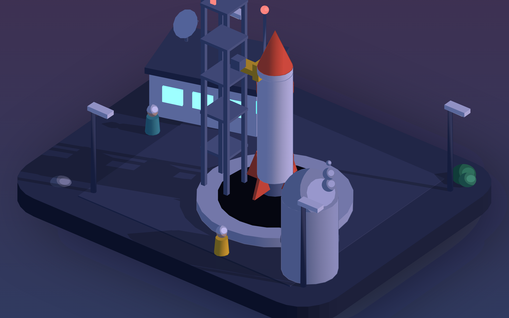
</p>

```text
A nocturnal orbital rocket launch facility at T-minus 10 seconds: a massive multi-stage heavy-lift rocket on a concrete launch pedestal, articulated hydraulic gantry tower arms swinging away, billowing white cryogenic LOX vapor clouds venting from booster valves, flame trench deflector channels, parabolic telemetry satellite dishes rotating on bunker roofs, and perimeter floodlights piercing the dark sky.
```
- **Key Props**: Multi-stage rocket booster with interstage fairings, launch umbilical tower, swinging service arms, cryogenic vapor particle emitters, tracking radar dishes, bunker telemetry array.
- **Interactions**: Tap launchpad to trigger countdown exhaust smoke; hover over telemetry dish to see orbital angle.

---

### 🌾 Automated Agritech Farm & Terraced Crop Estate

<p align="center">
  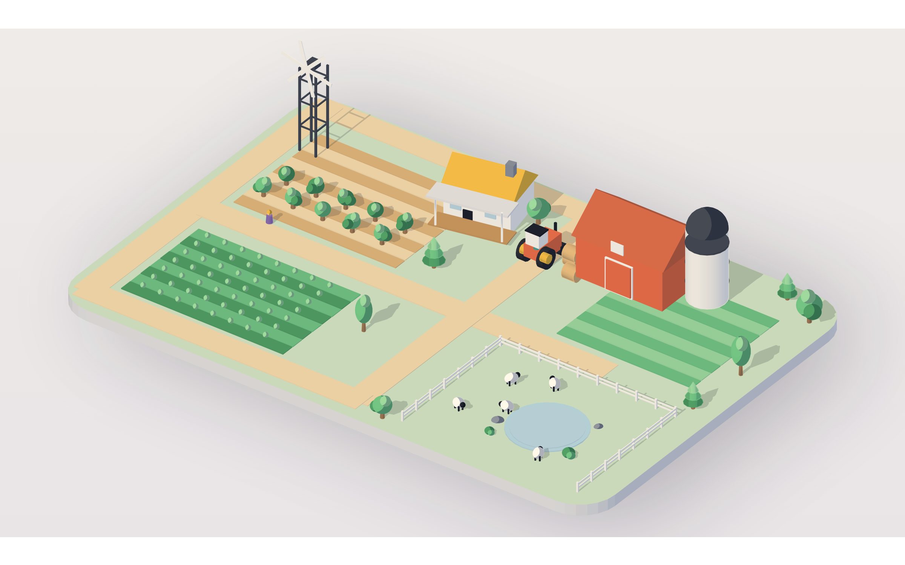
</p>

```text
A sprawling high-tech automated agricultural farm estate: expansive golden wheat fields and geometric hydroponic greenhouse domes, autonomous GPS-guided combine harvesters cutting crop swaths with rotating reel headers, corrugated steel grain elevator silos with conveyor chutes, solar tracking photovoltaic arrays, a turning aeration windmill, and an irrigation canal network with overflow sluice gates.
```
- **Key Props**: Crop field swaths, automated combines with rotating cutters, hydroponic glass geodesic domes, cylindrical grain silos, tracking solar panels, lattice windmill with spinning sails.
- **Interactions**: Hover over combine harvester to read crop yield metrics; click windmill to toggle rotation speed.

---

### 🏙️ Metropolis City Grid & Urban Architecture

<p align="center">
  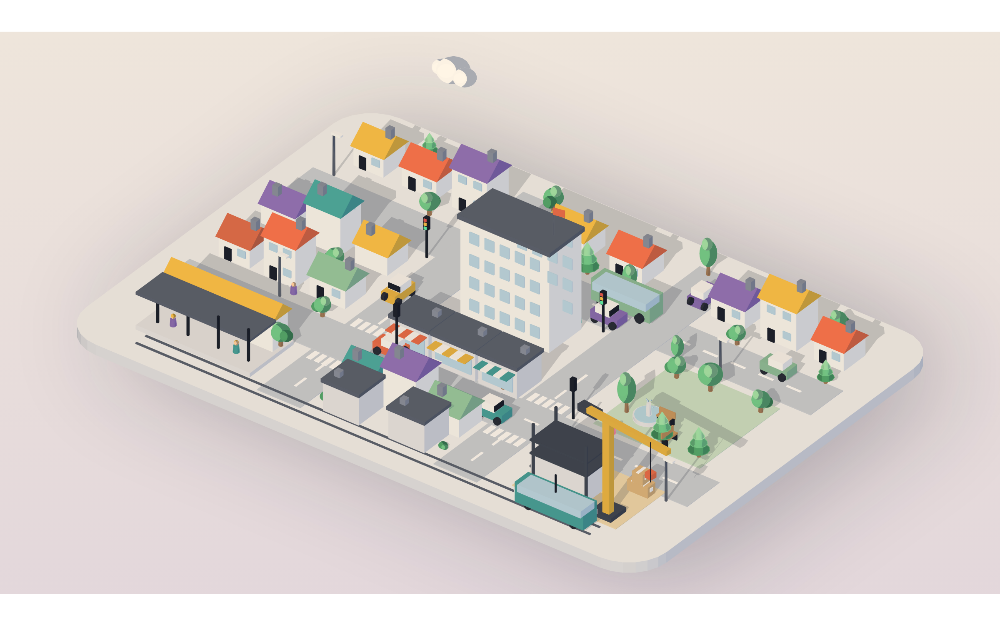
</p>

```text
A dense multi-level urban city center at twilight: towering brutalist skyscrapers with illuminated window grids, glass-enclosed skybridges linking high-rises, an elevated monorail train cruising on curved tracks, multi-lane asphalt highway carrying autonomous commuter pods, glowing holographic billboard advertisements, neon cafes with steam rising, and reflective street pavement.
```
- **Key Props**: Skyscraper cluster, skybridges, monorail with loop motion, neon billboards, highway with moving car pods, pedestrian overpasses.
- **Interactions**: Hover over skybridge reveals structural read-out; click monorail to toggle transit speed.

---

### 🔬 High-Altitude Observatory & Regional Airport

<p align="center">
  
  &nbsp;
  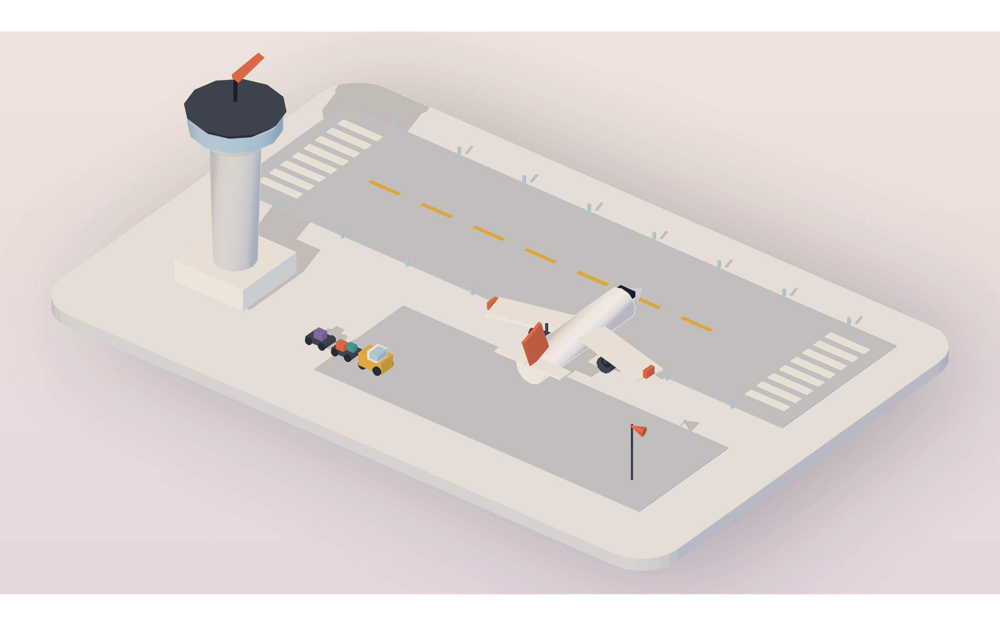
</p>

- **Astronomical Observatory**: Dual rotating silver domes with open aperture slits pointing reflecting telescopes toward the stars, satellite telemetry dish arrays, and cliffside funicular tramway.
- **Airport Hub**: Modern terminal building with jet bridges, taxiways with directional striping, twin-engine passenger aircraft taxiing, and a rotating 360-degree airport radar beacon tower.

---

## Quick Start

### Prerequisites

- **Node.js 20+** (v18.18+ supported)
- **npm** or **pnpm**
- *(Optional)* [Ollama](https://ollama.com) for fully offline, private generation
- *(Optional)* [Google Gemini API Key](https://aistudio.google.com/app/apikey) for cloud generation

### Installation

```bash
# Clone the repository
git clone https://github.com/Dostam-07/Any3d.git
cd Any3d

# Install dependencies
npm install

# Start development studio (Express API on :3001 + Vite frontend on :5173)
npm run dev
```

Open `http://localhost:5173` in your browser. Type a scene prompt, hit **Enter**, and watch your scene construct itself.

### Production Build

```bash
npm run build     # Compiles the React/Vite studio into dist/
npm start         # Serves static assets + Express API from port 3001
```

---

## Connect an AI Provider

Any3d supports dual AI providers, switchable at any time from the top header:

### 1. Ollama (100% Private & Local)

Run models locally with zero cloud dependencies and no API quota:

```bash
ollama serve
ollama pull qwen2.5-coder:7b
```

Any3d automatically enumerates installed Ollama models in the toolbar dropdown.

### 2. Google Gemini (Fast & High-Fidelity)

1. Get a free API key from [Google AI Studio](https://aistudio.google.com/app/apikey).
2. Click **Settings** (or the model badge in the toolbar) and paste your key.
3. The key is securely stored in your browser's `localStorage` and never shared externally.

### 3. Deterministic Procedural Fallback

No internet and no LLM installed? Any3d includes an offline procedural generator that crafts valid geometric scenes immediately without an AI model.

---

## Three Render Engines

Any3d houses three dedicated rendering engines sharing a unified prompt compiler and look system:

| Engine | Tech Stack | Aesthetic | Best For | Output Size |
|---|---|---|---|---|
| **SVG** | Dependency-free Vector SVG | 6 distinct vector themes, crisp lines, zero WebGL | Complex technical schematics, architectural line art, UI illustrations | ~30–35 KB |
| **Worlds** | Three.js / WebGL 2 | Soft miniature diorama, articulated figures, dynamic shadows | Narrative 3D worlds, industrial docks, cities, rocket launchpads | ~0.77 MB |
| **Pixel** | Software 2D Canvas Rasterizer | 320×240 retro resolution, 8×8 Bayer dither, dissolving edges | Nostalgic retro scenes, cozy farms, lightweight vignettes | ~50 KB |

<br />

### Engine Showcase

<p align="center">
  
  &nbsp;
  
</p>
<p align="center">
  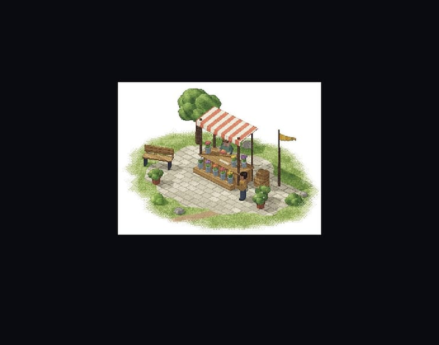
</p>

---

## Web Presentation Sizes: Hero vs Card

Any3d generates 3D scenes tailored to their real-world placement on the web:

<br />

| Presentation Format | Aspect Ratio | Camera & Stage Calibration | Ideal Placement |
|---|---|---|---|
| **Web Hero Section** | **16:9 Widescreen** | Panoramic boulevard bounds (`20.0 × 11.2`), wide camera frustum (`1.35×`), spacious multi-prop layout | Full-width landing page headers, sprawling city skylines, shipping docks |
| **Website Feature Card** | **4:3 Component** | Tight diorama bounds (`13.0 × 9.6`), focused component framing (`1.02×`), central pedestal emphasis | Feature cards, bento grids, standalone rocket launchpad pedestals |

Switch between **Hero** and **Card** with one click in the stage toolbar to see the stage and camera bounds adapt dynamically. In **Card** the scene owns the stage outright: the look controls live in a strip under the card (so the toolbar drops its copies of look and play), and there is no demo band above it — the scene is fitted against the real layout instead.

---

## Inside-Out Showcase: Hero and Card

Twelve captures taken straight from the running studio with `node scripts/showcase.mjs` — no retouching, no mock layout:

- **Six hero sections** (full-bleed banner: nav, one headline, one CTA) and **six card sections** (one live 4:3 card, as large as the stage height allows, with the look controls as a thin strip under it). The scene is the only subject of the frame: nothing in the card presentation competes with it. The card is sized by fitting the real layout — set the width, read how much the stage overflows or has spare, correct — so no assumed header or caption height can drift. The export lives once, in the stage toolbar next to the PNG snapshot; it used to be a third card called *Ship this scene*, which only repeated the download the project header already offers.
- Each presentation mixes **four presets** with **two prompt-only scenes that are not in the preset library** (night market, glacier lighthouse, rooftop greenhouse, coral nursery). Those four were typed as prompts and generated end to end, which is how the framing and coverage bugs below were caught.
- Two hero banners are looping GIFs because their motion is the point: crane travel on the harbour, lantern sway in the night market. Everything else is a still.

<h3 align="center">Hero Sections — 6 scenes</h3>

<table>
  <tr>
    <td width="50%" align="center">
      <a href="docs/assets/showcase/harbour-hero.png" title="Open the full-resolution still">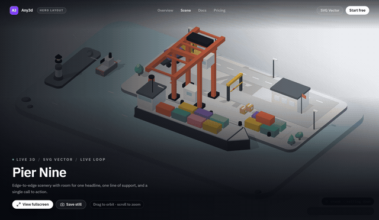</a><br />
      <sub><b>harbour</b> · SVG Vector · preset — blueprint gantry cranes over water</sub>
    </td>
    <td width="50%" align="center">
      <br />
      <sub><b>florist</b> · Three.js · preset — warm shop front with a street of planters</sub>
    </td>
  </tr>
  <tr>
    <td align="center">
      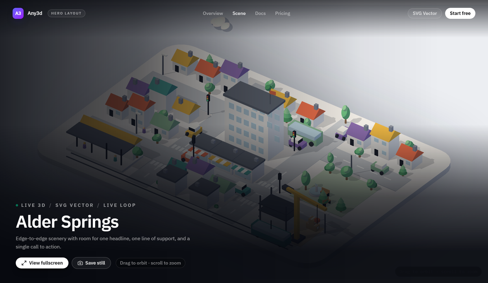<br />
      <sub><b>town square</b> · SVG Vector · preset — a whole town block with roads and traffic</sub>
    </td>
    <td align="center">
      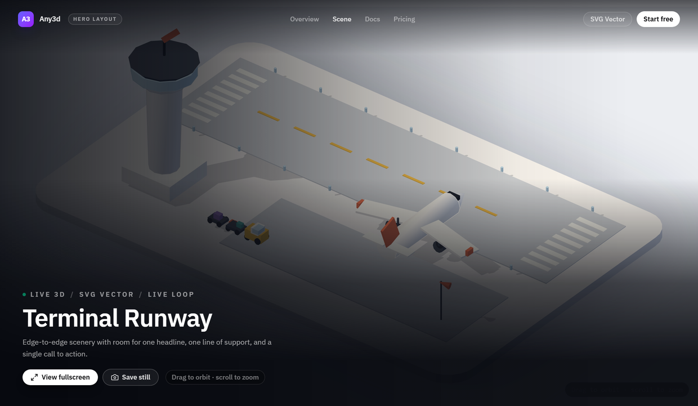<br />
      <sub><b>airport</b> · SVG Vector · preset — terminal, apron and runway lights</sub>
    </td>
  </tr>
  <tr>
    <td align="center">
      <a href="docs/assets/showcase/market-hero.png" title="Open the full-resolution still"></a><br />
      <sub><b>night market</b> · Three.js · <i>prompt only</i> — “a bustling night market with noodle stalls and paper lanterns”</sub>
    </td>
    <td align="center">
      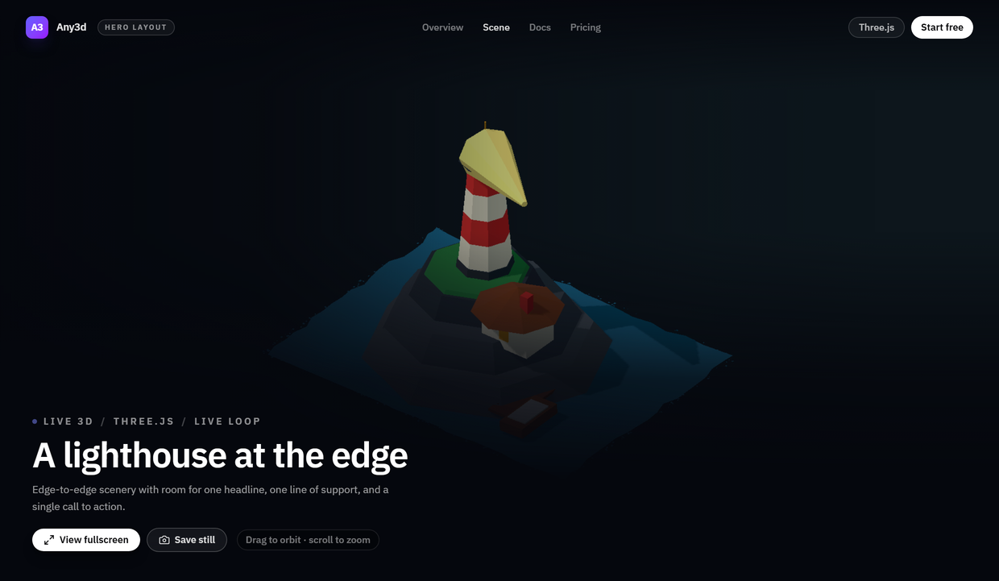<br />
      <sub><b>glacier lighthouse</b> · Three.js · <i>prompt only</i> — “a lighthouse at the edge of a glacier with a stranded research hut”</sub>
    </td>
  </tr>
</table>

<h3 align="center">Card Sections — 6 scenes</h3>

<table>
  <tr>
    <td width="33%" align="center">
      <br />
      <sub><b>bakery</b> · Three.js · preset</sub>
    </td>
    <td width="33%" align="center">
      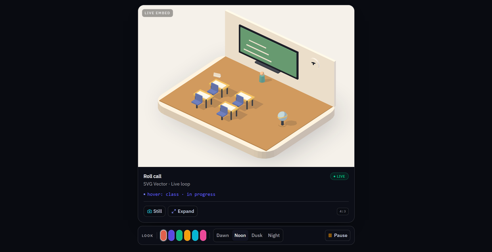<br />
      <sub><b>classroom</b> · SVG Vector · preset</sub>
    </td>
    <td width="33%" align="center">
      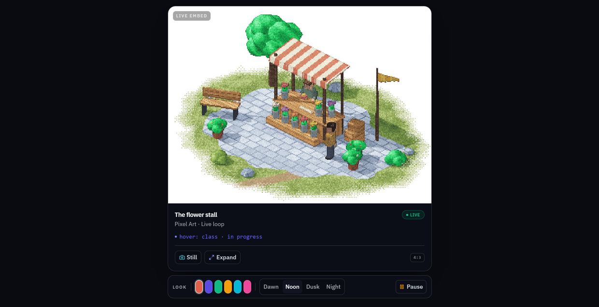<br />
      <sub><b>flower stall</b> · Pixel Art · preset</sub>
    </td>
  </tr>
  <tr>
    <td align="center">
      <br />
      <sub><b>fishing pier</b> · Pixel Art · preset</sub>
    </td>
    <td align="center">
      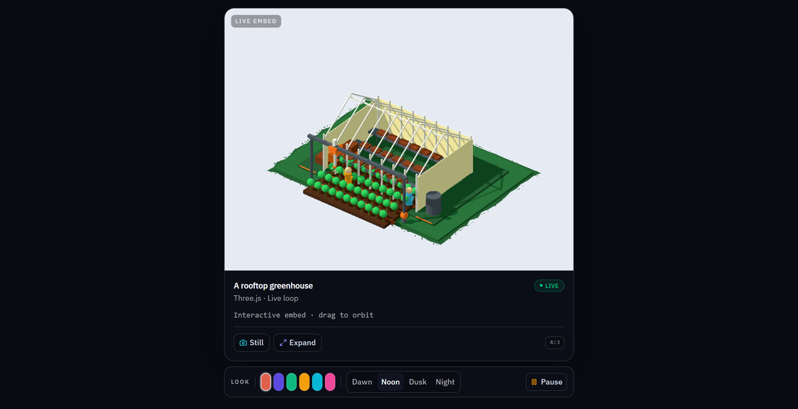<br />
      <sub><b>rooftop greenhouse</b> · Three.js · <i>prompt only</i></sub>
    </td>
    <td align="center">
      <br />
      <sub><b>coral nursery</b> · Three.js · <i>prompt only</i></sub>
    </td>
  </tr>
</table>

### The same six heroes at dusk

The look is a runtime message, not a rewrite, so the same presets re-shot under `A3D_LOOK=dusk` should be the same compositions lit differently — and they are, which is the point of keeping the set beside the noon one.

<table>
  <tr>
    <td align="center">
      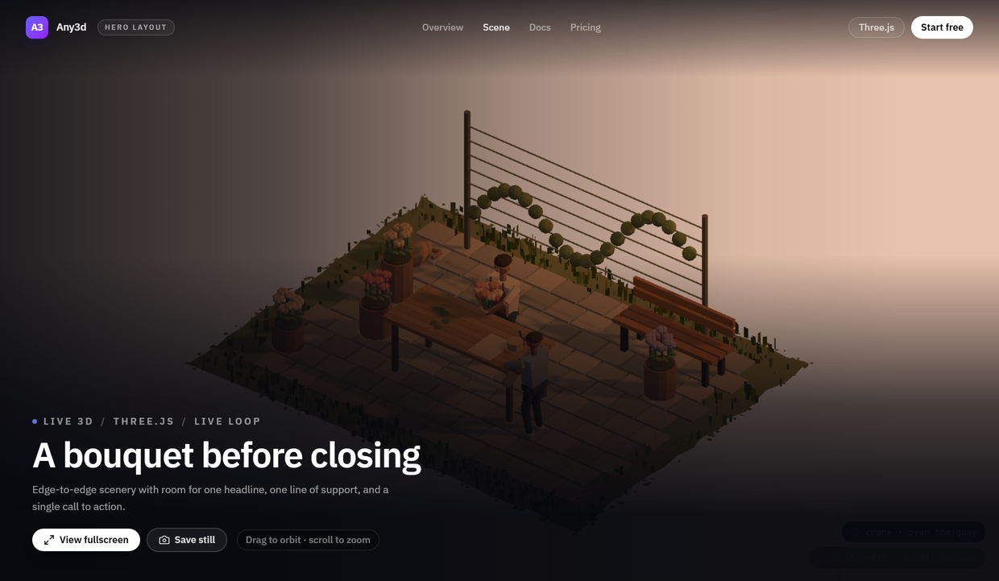<br />
      <sub><b>florist shop front</b> · Three.js · <i>dusk</i></sub>
    </td>
    <td align="center">
      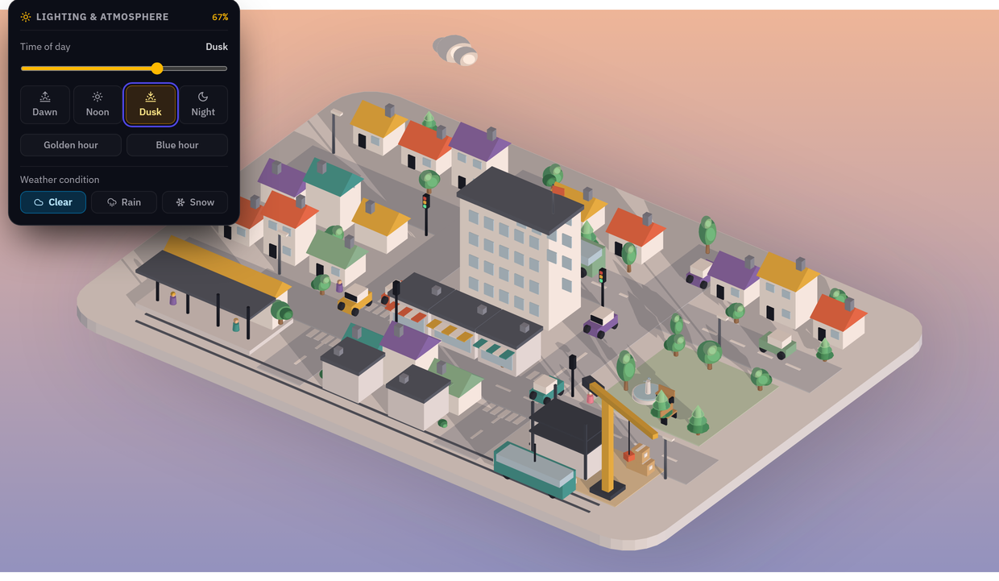<br />
      <sub><b>town square</b> · SVG · <i>dusk</i></sub>
    </td>
    <td align="center">
      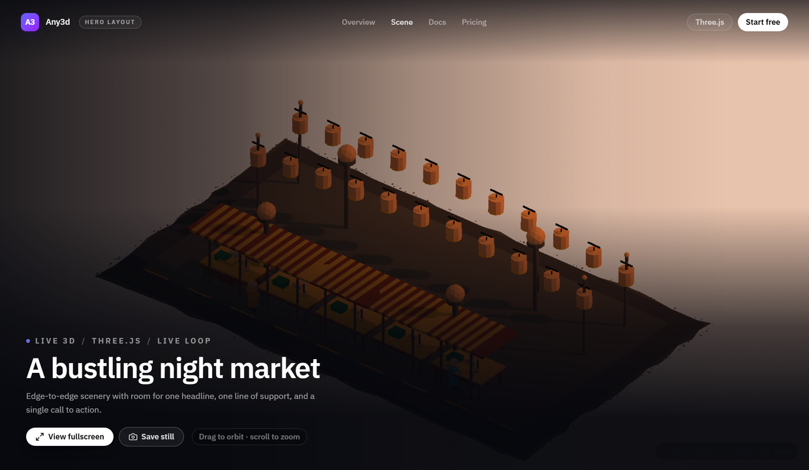<br />
      <sub><b>night market</b> · Three.js · <i>prompt only, dusk</i></sub>
    </td>
  </tr>
</table>

`npm run verify:dusk` compares each dusk still with its noon twin on the same luminance grid the fidelity check uses: an unapplied look leaves the two files the same picture, so a whole time of day cannot be lost quietly. Mutation-tested by copying a noon still over its dusk twin (mean Δ 0.0, check fails).

The two prompt-only worlds per presentation were sent through the same `POST /api/generate` path the studio uses. On this CPU-only machine the local 7B model exceeded the generation timeout, so the request fell back to the built-in procedural composer — that composer output is what the screenshots show, and it is the reason the fallback was rebuilt (see below).

### What this audit run fixed

| Found while shooting the showcase | Fix |
|---|---|
| Any prompt outside a hand-written category produced the same courtyard: pergola, table, one person. | `server/engine/custom-world.js` now composes from the prompt's own nouns — palette profile (`ice`, `underwater`, `volcanic`, `orbital`, `market`, `industrial`, `garden`, `desert`) plus set pieces (stalls, lanterns, lamp posts, greenhouse, crop rows, watering arm, coral, bubbles, huts, glaciers, domes, solar arrays). |
| Worlds written with the SVG API passed validation, then failed bundling with `Could not resolve "@any3d/figure"` → HTTP 500. | `validateWorlds()` rejects `D.*`, `pal.*`, `Any3d.*`, `Pixel.*` and any import other than `@any3d/worlds`. |
| The ordered-dither engine shipped as a fourth format nobody asked for, doubling the bundle and kernel surface for a look the pixel engine already covers. | Removed: kernel, bench template, four presets, prompt/validator/bundler branches and the gallery tab are gone. Two showcase tiles that used it were re-shot with SVG and pixel scenes. |
| Pixel scenes appeared as a postage stamp in the middle of the stage, because the canvas kept its native 320×240 box. | `fit()` scales to the largest whole-number multiple of both stage axes — in the studio and in exported files. |
| The default (noon) look painted the stage pure white behind every scene. | Noon background is a soft studio tone (`#e6ebf3`). |
| Every Three.js scene sat on a near-black backdrop under bright noon lighting, so a hero banner read as a black rectangle on any light page: `world-bench.html` ignored the studio's `look` message and the runtime never applied a profile at mount. | The world runtime applies the default look on mount and honours `look` / `size` / `finish` / `paused` / `camera` messages; exports carry the look for every format, not just SVG. Guarded by a *world look reaches the runtime* check (noon sky 236 → night 47). |
| Hero framing zoomed out 1.35×, leaving a wide dead margin around the scene. | 1.08× — the scene reaches the banner edges and tall props still clear the top. |
| Removing the dither engine left a trailing `|` in the worlds validator's foreign-API regex, so it matched the empty string: **every** world was reported invalid, including the four prompt-only showcase scenes the README points at as proof that unseen prompts work. Nothing caught it because no test validated a known-good world. | Pattern fixed; `verify-worlds-api.mjs` now validates a real world (must pass), rejects a world using `D.slab` (must fail, naming the call), and re-validates the four prompt-only showcase scenes. |
| Nothing noticed a scene that still draws but stopped looking like itself — a swapped model, a collapsed silhouette, a presentation that lost its framing. | `scripts/verify-still-fidelity.mjs` re-shoots the 8 preset README stills through the studio into `.tmp/fidelity` and compares each with the committed one on a 64 × 36 luminance grid over the top 82% of the frame, searched over a ±4% scale window and a ±2-row shift because a card's crop follows font metrics and scrollbar width. Same-scene noise has fallen to mean 0–0.18 with no hot cells; cross-pairing a still with a different scene still fails all 8 (mean 4.8–107.7), so the limit stays mean ≤ 3 and ≤ 5% hot. Prompt-only stills are excluded: their composer is not reproducible across machines, so they are re-shot rather than compared. |
| The pixel kernel had no contract test at all: `P.snap` and `P.wind` only exist after the first render, so a scene calling them from `build` silently got a no-op and plain `P.wave`, and nothing would have noticed if any of the 24 documented `P` entries stopped drawing. | Documented the timing, and added `scripts/verify-pixel-api.mjs`: it calls every `P` entry with sane and with non-finite arguments, rasterises both scenes and fails on a missing call, a throw, an empty frame or non-finite stats. |
| A non-numeric `seg` on `D.cyl` (or a NaN extent on any SVG primitive) threw inside the painter and blanked the whole figure, with no clue in the markup. | Every `D` primitive coerces sizes, positions and segment counts; `scripts/verify-svg-api.mjs` calls all 23 primitives and 10 motion helpers from the kernel header and fails if a bad argument throws or leaves `NaN` in the SVG. |
| The documented `segments` argument on `W.cylinder` was silently dropped in both call shapes, so presets asking for 10, 16, 20 or 32 segments (the pottery wheel, its pots and cans) all rendered at 8. | Both shapes read the argument again (`scripts/verify-worlds-api.mjs` asserts it), and every documented primitive is now called in CI with sane and with non-finite arguments. |
| The camera menu (isometric / top / front / side) changed its own label and nothing else: the world bench dropped `camera` messages too, and the SVG runtime had no runtime camera at all. | Worlds accept `{ az, el, dist }` and refit; SVG gained `ctx.setCamera` that sets the rest angle and refits the frustum; *Isometric View* restores each scene's authored angle; the control is hidden for the pixel engine, which has no camera. Guarded by three checks (`world camera presets apply`, `svg camera presets apply`, `camera hidden for the 2D engines`). |
| Reopening a project — a reload, a link opened on a phone — restored the transcript and the 121-line scene but never rebuilt the bundle, because the bundled html lives in memory only and the deep-link effect skipped out as soon as the session was already current. The preview pane insisted "your scene will appear here as soon as the first generation finishes" above a valid scene, and every capture action was disabled. | The deep-link effect now rebuilds the bundle whenever the page has code but nothing to show for it, while leaving a live session's frame alone. `verify-storyboard.mjs` opens the same scene on a 414×900 phone and fails without the fix (no iframe, empty preview). |
| The capture chips (Clip, Storyboard) collapse below `md`, and the narrow-screen actions menu only offered theme, settings, seed, compare and GLB — so a phone had no way to record a clip or build a sheet. | Both controls render a full-width `variant="menu"` row inside that menu, and `verify-storyboard.mjs` builds a sheet from the phone menu (20 checks). |
| Light mode kept black holes: the workspace toolbar, the card tiles and the card stage gradient stayed near-black under a light page. The surface classes are written with opacity suffixes (`bg-[#0c0e17]/95`, `bg-zinc-950/90`) and the light-theme remap enumerated exact classes, so anything with an unlisted opacity matched nothing; the stage gradient's stops (`via-[#0a0c13]`) were not backgrounds at all. | The remap now matches on a substring, covers every dark hex family in the app, and drops the gradient in light mode. `verify:showcase` walks the DOM in light mode and fails on any near-black surface bigger than a chip — reading colours through a canvas, because Tailwind resolves opacity-modified colours to `oklab()` and an `rgb()` regex silently skipped exactly the surfaces that were still black. |
| The card presentation put the scene beside its own *Look* card, so two tiles of equal weight shared a frame and the thing the user came to look at was half of it; a chip strip above them repeated the engine, motion and look a third time. | The look card is gone: the scene card takes the full width the stage height allows and the look controls ride underneath as a thin, single-row strip, with the redundant spec chips removed. The width is fitted against the real layout — set it, measure the overflow or the spare room, correct, repeat — after the previous hard-coded header/caption allowances proved to drift whenever a scene name wrapped. `verify:showcase` asserts one tile, the strip sitting flush under the card, and a crop that keeps at least 40% of a short stage (mutation-tested: the old two-tile grid fails all three). |
| The card caption's title, metadata and buttons were hard-coded dark-theme greys, so in light mode the card surface turned white and the near-white title almost vanished. | `LiveCardBody` reads the theme tokens (`--text-primary`, `--text-muted`, `--surface-secondary`, `--border-subtle`) and the card surface uses `--surface-primary`, so the caption is legible in both themes. |
| The card presentation carried a third card, *Ship this scene*, with its own Export HTML button, a copy button and a peek at the source — all of it repeating the download the project header already offers, and the hub stage had no export button of its own. | The card is gone. The export lives once, as an `HTML` chip in the stage toolbar next to `PNG`, so both the hub and the project page reach the same action; the card grid is two tiles, and `verify:showcase` fails if an export panel reappears inside the card stage. |
| The storyboard was only reachable from the studio hub's stage toolbar, so a user working in a project — where every other capture action lives — had no way to make a sheet. | The control sits in the project page header next to the clip button, and `verify-storyboard.mjs` now runs the whole flow there (20 checks, desktop and phone) while still asserting the hub entry survives. |
| The storyboard sheet ignored the frame the user set up: it always drew the same four angles whatever the presentation or the camera pick, and it rasterised whichever `<svg>` the stage held first — a stale mount — so tiles could repeat a neighbour instead of showing their own angle. | Tiles mount at the chosen presentation size, `storyboardAngles` leads with the user's own angle when they picked one (`Your angle · Turned left · Turned right · Lower/Higher angle`), each tile is rasterised from the mount it just made, and the burned-in labels name the angles that were actually rendered. Guarded by `scripts/test-storyboard.ts` (16 checks in `npm test`) and `scripts/verify-storyboard.mjs` (20 checks in CI). |
| The camera pick was studio-only: the menu moved the live stage, but the exported file reopened at the angle the scene was authored for, and a share link forgot it entirely. | The pick is lifted to the app (`CameraPick` in `src/lib/camera.ts`), rides `POST /api/bundle` into the file (`window.__any3dCamera` for SVG, `initialCamera` for worlds) and into `ScenePayload.camera`, and a pick that cannot be applied is dropped instead of reaching `setCamera`. Guarded by `scripts/verify-export-camera.mjs` (11 checks) and three payload round-trip assertions. |
| A project opened cold — a refresh, a bookmark, a link on another machine — restored the transcript and the code but not the frame, because the bundled html lives in memory only. The regression was only guarded from inside the storyboard suite, so a change to the deep-link effect could have broken the plain reload unnoticed. | `scripts/verify-reload.mjs` (5 checks, wired into CI) loads a preset, reloads the project URL and asserts a live frame with the scene drawn in it, no empty-state copy, and enabled capture actions. Mutation-tested: restoring `if (false && !currentBundledHtml …)` produces 0 iframes and the empty-state text. |
| The home page's "Curated Inspirations" were six written prompts with nothing to look at — a scene generator whose landing page showed no scenes — and clicking a card did nothing at all, because the preview frame inside it swallowed the click. | The grid shows six real presets, each bundling and running on the card, loaded only when scrolled into view. The frames are `pointer-events-none` by default so the card gets the click (`interactive` opts back in), the arrow rode onto the picture to give the title its width, and every card carries the same single meta line so the rows keep one height. `verify:showcase` asserts the six cards draw scenes, share one height, fit their titles, and that one opens a project. |
| A world is framed from the `bounds` box it *declares*, not from the geometry it builds — and those declarations had drifted. The humanoid composer framed `±3.5 × −0.6…3.6` around a slab that only reaches `±3.3 × 2.8`, so a character stood small in the middle of its own banner; the abstract gimbal declared nearly twice its real size and filled a fifth of the frame; five other composers built past their own box (`city` reached y 10.1 above a declared 9), which the camera answered by cropping. | The humanoid box is measured (`±3.4 × −0.55…2.9`), the gimbal box is measured (`±1.9 × 3.05`), and the runtime now frames the **union** of the declared motion envelope and the geometry actually built, so a declaration can add air but can never cut the top off a scene. `npm run verify:bounds` mounts twelve procedural worlds, measures each silhouette against a committed baseline and fails on a scene that shrank or touches the frame edge (mutation-tested both ways: the old humanoid box reads 49%/47% vs the recorded 58%/55%; a 0.62× framing multiplier trips the clipping check). All twelve stills were re-shot; fidelity is back to 9/9. |
| Every bundle path except export and share was built without the look and the camera, so a scene's first frame was painted at noon from its authored angle and only corrected when the runtime reported ready. On this machine that flash is visible, and it meant two code paths disagreed about what "the scene the user set up" means. | All ten `bundleCode` calls now carry `stageLook` and `stageCamera`, the same pair the export and the share link already used. The showcase shoots the dusk set through the real look control (`A3D_LOOK=dusk`), and `npm run verify:dusk` compares each dusk still against its noon twin so a look that stops reaching the picture fails the build. |
| The preset gallery — the screen where you browse forty scenes — listed names, file paths and line counts and showed no scenes at all. | It is a split view now: compact rows on the left, the chosen preset bundled and running in a live frame on the right, with the bundle cached per preset and the pointer driving the preview. `verify:showcase` asserts the frame draws the scene (776 SVG shapes), and that hovering a Three.js preset swaps in a canvas. |
| Two controls were doing one job in the editor: the engine was selectable in the app bar *and* again under the composer, and the card presentation repeated the look and the play state it already had in its own strip. | The composer's engine switcher is gone (the app bar owns the format), and in Card the toolbar drops `LookScrubber` and the play/pause chip. `verify:showcase` counts them in the card presentation and fails if either comes back (mutation-tested). |
| The card stage carried a marketing band (“Cards section / Your scene as a card in a section”) above the scene being edited, which cost 54px of scene height at every width. | The band and its `CardSectionHeader` component are gone; the card fitted to the empty stage grows from 687px to 773px wide on a 2200×950 pane, with the crop 578px tall instead of 514px. Guarded by `the stage has no demo band above the scene`. |
| Generated scenes showed a slug in the headline and exports: “a-bustling-night-market-with-n”. | `src/lib/scene-title.ts` prefers the scene description, drops a truncated tail, and trims dangling connectors. |
| A 4:3 card section left a tall empty tail in a squarish stage. | The card section measures its content and compacts itself; the showcase crops stills to the content box. |
| Switching Hero ↔ Card rewrote the scene source, re-bundled it and reloaded the frame — the camera pose was lost and the code editor quietly changed. | The size is a runtime message to the live frame; only the exported file is stamped (`src/lib/presentation-size.ts`). Verified: the iframe document survives every switch. |

To regenerate everything: start the API (`node server/index.js`) and the app (`npm run dev`), then run `npm run showcase` (pass scene keys to re-shoot a subset, `npm run showcase:gifs` to record the two animated banners, and `A3D_LOOK=dusk A3D_OUT=docs/assets/showcase/dusk npm run showcase` to re-shoot the dusk set — it drives the look control, not a fixture). The four prompt-only scenes are rebuilt deterministically by the script itself, so a clean checkout can reproduce every image.

Stills are normalised to 1240 px wide and GIFs to 640 px, so GitHub renders every tile at the same scale.

Before pushing, `npm run check` runs the test suite, the typechecker and the production build — it is also wired to `.githooks/pre-push` (`git config core.hooksPath .githooks` once per clone), so a red build cannot be pushed; `SKIP_CHECK=1 git push` bypasses it. `npm run verify:showcase` covers the live presentation invariants and needs the API and app running. Point the checks at the address the dev server actually bound (`A3D_URL=http://127.0.0.1:5174` if Vite bound IPv4 only): `localhost` can resolve to the other family and a stale server then answers, which makes an edit look like it had no effect.

CI keeps this honest:

| Workflow | What it does |
|---|---|
| `.github/workflows/ci.yml` | `npm test`, `tsc --noEmit`, `npm run build`, then boots the API and app and runs `npm run verify:showcase` — 31 presentation invariants (the home grid runs six real scenes and one of them opens, the frame survives Hero ↔ Card, the gallery previews the scene it lists and marks the row it shows, the card stage carries no demo band and does not repeat the toolbar's look or play controls, no duplicate export, the stage toolbar exports a standalone file, the card fits a short stage, light mode has no black surfaces, pixel art fills its frame, console clean) — plus the contract walks for each kernel (`verify:pixel-finish`, `verify:svg-api`, `verify:pixel-api`, `verify:worlds-api`), `npm run verify:camera` for the camera an export carries, `npm run verify:storyboard` for the storyboard framing on the project page, `npm run verify:reload` for a project opened cold (the bundle is memory-only, so a refresh has to rebuild it), `npm run verify:fidelity` to re-shoot the README stills, `npm run verify:bounds` to mount every procedural world and check it fills its frame without being clipped (against a recorded baseline, so a scene cannot quietly shrink), and `npm run verify:dusk` to prove the dusk stills below are actually lit dusk rather than a noon picture filed under a new name. |
| `.github/workflows/showcase.yml` | Weekly / on demand: re-captures all twelve scenes with `showcase:gifs`, uploads them as an artifact, and commits the refreshed images only when `commit_images` is set. |

---

## Six Live Themes & Four 3D Finishes

### SVG Vector Themes

Repaint any SVG scene instantly in sub-5ms without regeneration or model calls:

<p align="center">
  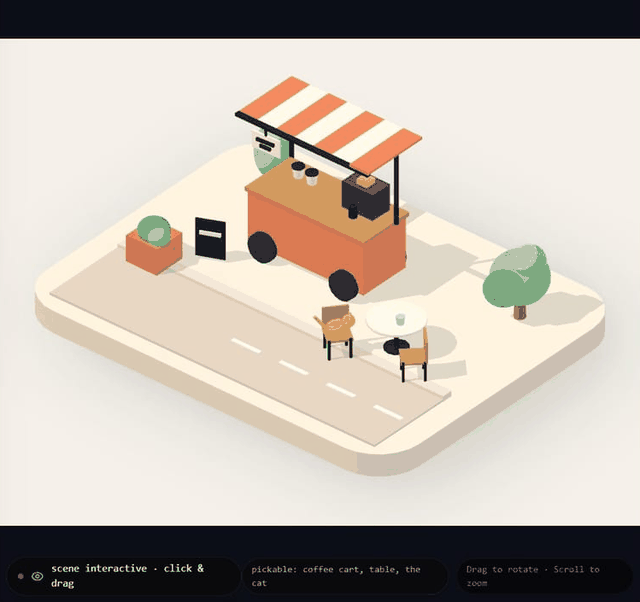
</p>

- **Toy**: Saturated, joyful primary palette with clean outlines.
- **Soft**: Pastel tones with gentle warm shading.
- **Mono**: High-contrast editorial monochrome.
- **Line**: Technical architectural wireframe with zero fill.
- **Night**: Dark luminescent cyber aesthetic with glowing accents.
- **Print**: Risograph and newspaper halftone dot aesthetics.

### Worlds 3D Finishes

Switch the 3D post-processing shader stack:
- **Miniature**: Soft depth-of-field diorama with ambient occlusion.
- **Pixel**: Real-time 3D pixelation pass.
- **Halftone**: Comic-book style screen-tone dots.
- **Blueprint**: Technical CAD schematic drafting finish.

---

## Atmosphere & Lighting Scrubber

Control scene lighting, sun elevation, shadows, and weather in real time:

- **Time of Day**: Dawn, Noon, Dusk, Night, Golden Hour, and Blue Hour.
- **Weather Particles**: Clear, Animated Rain, and Falling Snow.
- **Persistent State**: The chosen atmosphere is automatically encoded into export HTML files and URL-hash payloads (`#/s/...`).

---

## Web Visual Grounding

When you prompt a complex scene — such as *"an industrial deep-water container dock with a cargo ship and gantry cranes"* or *"an automated agritech farm with combines and grain silos"* — Any3d performs automated background visual research on Wikimedia Commons.

- **Authentic Photographic Studies**: Gathers real photographs of the exact subjects requested (real container gantry crane truss geometry, real ship draft waterlines, real combine harvester cutting reels).
- **No Mock or Fake Data**: Never uses generic placeholders or hallucinated geometries. Real-world proportions, color palettes, and architectural scales directly ground the scene generator.

---

## AnyStack 3D Arcade

Waiting for a model generation or want to take a creative break? Click **AnyStack** in the 3D toolbar to play an integrated physics-based 3D block stacking minigame directly on the 3D stage.

---

## Deterministic Validation & Inspector

Every generated scene passes an automated quality harness before rendering:

<p align="center">
  
</p>

- **Clock Purity**: Ensures all animation loops derive strictly from the kernel timestamp `t` (no uncontrolled `Date.now()` or `Math.random()` jitter).
- **Ground Pedestal Bounds**: Confirms geometry remains contained on the diorama base.
- **Pointer & Picking Hooks**: Verifies hover highlights, name read-outs, and interactive click events.
- **Prompt Fidelity**: Evaluates presence of mandatory subjects, props, and actions (0–100 score).
- **Self-Healing Bundler**: Automatically fixes unclosed tags, malformed transforms, and missing imports.

---

## Curated Preset Library

Browse 40 production-grade scenes across all three engines via the **Presets** gallery (`Ctrl/⌘ K`). It opens as a split view: the list on the left, the selected scene **running live on the right** — hovering a row swaps the frame, and bundles are cached per preset, so flicking through forty scenes does not refetch forty times:

<p align="center">
  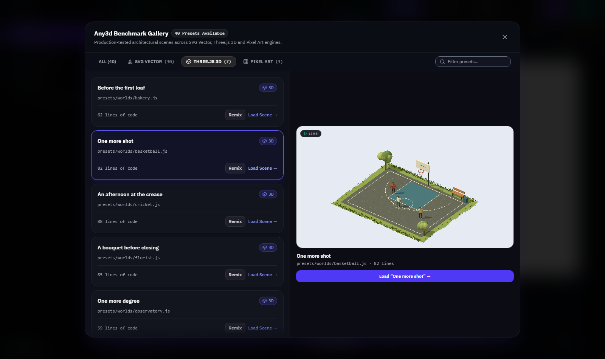
</p>

- **SVG (30)**: `town`, `island`, `farm`, `warehouse`, `powder`, `cafe`, `launchpad`, `server`, `rack`, `mailbox`, `seedling`, `desk`, `turntable`, `harbour`, `kitchen`, `assembly`, `observatory`, `vending`, `airport`, `badminton`, `barbershop`, `gym`, `laundromat`, `library`, `arcade`, `classroom`, `foodtruck`, `greenhouse`, `campsite`, `patisserie`.
- **Worlds 3D (7)**: `bakery`, `pottery-studio`, `florist`, `observatory`, `cricket`, `basketball`, `street-juggler`.
- **Pixel (3)**: `flower-stall`, `pier`, `allotment`.

---

## Export Suite

Any3d is built to deliver assets ready for production deployment:

| Export Target | Format | Description |
|---|---|---|
| **Standalone HTML** | `.html` | Completely self-contained single-file bundle. Inlined CSS, runtime, and scene logic. Zero dependencies, works offline. |
| **Binary GLB** | `.glb` | Standard 3D scene graph for import into Blender, Unity, Unreal Engine, or Godot. |
| **PNG Snapshot** | `.png` | 2× high-resolution crisp image snapshot with transparent or styled background. |
| **Turntable Video** | `.webm` / `.gif` | Smooth 360-degree rotating camera clip recorded directly from the canvas. |
| **Compressed URL Link** | `#/s/...` | Losslessly compressed scene payload in the URL hash. Share complete scenes without server storage. |
| **Embed Script** | `<script>` | Drop any scene onto your existing website using `embed.js` (sandboxed, responsive iframe). |

---

## Mobile Responsive Design

Any3d is built mobile-first and fully responsive across smartphones and tablets. The studio interface dynamically adapts for touch-first screens:

- **Mobile Home Studio**: The prompt capsule, engine selectors, aspect ratio switches, and the live preset grid stack into an ergonomic single-column view with touch-friendly controls.
- **Mobile Project Studio**: The conversation assistant and interactive 3D viewport stack vertically with progressive disclosure menus for camera presets, lighting scrubbers, and live preview tabs.

<p align="center">
  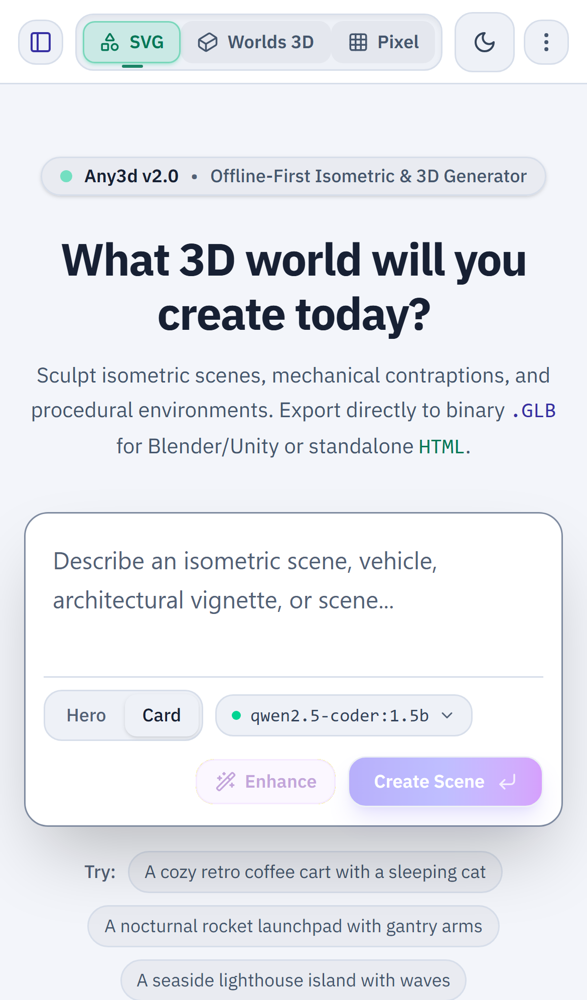
  &nbsp; &nbsp;
  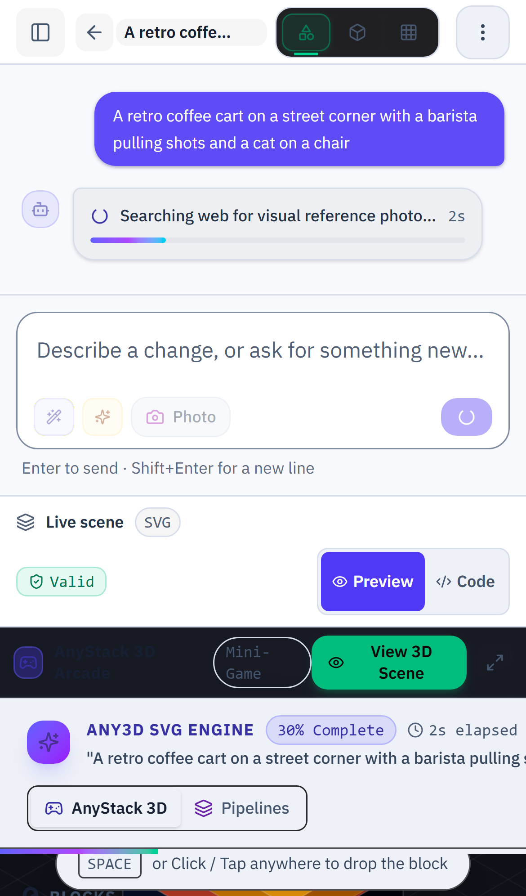
</p>

---

## Keyboard Shortcuts

| Shortcut | Action |
|---|---|
| `Ctrl/⌘ + N` | Create a new scene project |
| `Ctrl/⌘ + K` | Open the Preset Scene Gallery |
| `Ctrl/⌘ + J` | Toggle the conversational chat drawer |
| `Ctrl/⌘ + I` | Open the Scene Validation Inspector |
| `Ctrl/⌘ + B` | Toggle the project sidebar |
| `Enter` | Send generation / edit prompt |
| `Shift + Enter` | Insert new line in prompt composer |

---

## Project Architecture

```
Any3d/
├── core/
│   ├── kernels/            # Three core render kernels (SVG, Worlds, Pixel)
│   └── templates/          # HTML bench templates for standalone bundling
├── server/                 # Express backend API (:3001)
│   ├── engine/
│   │   ├── bundler.js      # Self-healing HTML bundler + Three.js esbuild packager
│   │   ├── validator.js    # Deterministic scene validator
│   │   ├── fidelityValidator.js  # Semantic prompt coverage & scoring
│   │   ├── procedural.js   # Deterministic offline procedural fallback generator
│   │   └── semantics.js    # Subject, prop, and layout semantics extractor
│   ├── llm/
│   │   ├── service.js      # Dual-provider LLM coordinator (Gemini & Ollama)
│   │   ├── prompts.js      # Engine-specific system prompts & syntax rules
│   │   ├── enhancer.js     # Prompt expansion & real-world photo researcher
│   │   ├── mutator.js      # Conversational differential scene editor
│   │   └── offline-editor.js   # Sub-5ms deterministic AST editor (SVG)
│   └── presets/            # Source code for preset scenes
├── src/                    # React 19 + Vite 6 frontend
│   ├── components/         # Homepage, ProjectPage, SandboxPreview, LookScrubber, AnyStack...
│   ├── lib/                # glbExporter, turntable, look, scene-payload, api
│   └── types.ts            # Core TypeScript schemas
├── docs/
│   ├── assets/             # Screenshots, GIFs, and engine comparison cards
│   ├── guides/             # In-depth architectural and authoring guides
│   └── ROADMAP.md          # Project milestones and feature roadmap
└── public/
    └── embed.js            # Standalone zero-dependency embed script
```

---

## Documentation Guides (`docs/guides/`)

- **Vector SVG**: [SVG Craft](docs/guides/svg-craft.md) • [SVG Motion Loops](docs/guides/svg-motion.md) • [SVG + React](docs/guides/svg-react.md)
- **Three.js Worlds**: [Worlds Art Direction](docs/guides/worlds-art-direction.md) • [Worlds Scene API](docs/guides/worlds-scene-api.md)
- **Pixel Art**: [Pixel Art Direction](docs/guides/pixel-art-direction.md) • [Pixel Scene API](docs/guides/pixel-scene-api.md)
- **Exports & Embeds**: [Turntable Export](docs/guides/turntable-export.md) • [Embed Script & Storyboard](docs/guides/embed-and-storyboard.md)
- **Atmosphere**: [Atmosphere & Look Scrubber](docs/guides/atmosphere-and-look.md) • [Palette from Photo](docs/guides/palette-from-photo.md)
- **Architecture**: [Scene Payload Protocol](docs/guides/scene-payload.md) • [Version Diff & Seeds](docs/guides/version-diff-and-seeds.md)

---

## FAQ & Troubleshooting

<details>
<summary><b>Does Any3d require an active internet connection?</b></summary>
No. When using Ollama with local models or the built-in procedural generator, Any3d operates 100% offline. Exported HTML files also function completely offline with zero external network requests.
</details>

<details>
<summary><b>Where is my scene data stored?</b></summary>
All project sessions, chat histories, and custom scenes are persisted locally in your browser's <code>localStorage</code> (keys: <code>any3d_saved_sessions</code> and <code>any3d_chat_history</code>).
</details>

<details>
<summary><b>Can I import Any3d models into Blender or Unity?</b></summary>
Yes. In the Worlds 3D engine, click <b>Export → GLB</b> to download a standard binary <code>.glb</code> file containing the Three.js mesh geometry and materials.
</details>

<details>
<summary><b>Port 3001 or 5173 is already in use. How do I change it?</b></summary>
You can start the frontend and backend individually with custom ports:
<code>PORT=3005 npm run dev:server</code> and <code>npm run dev:client -- --port 5175</code>.
</details>

---

## License

This project is licensed under the [MIT License](LICENSE).
