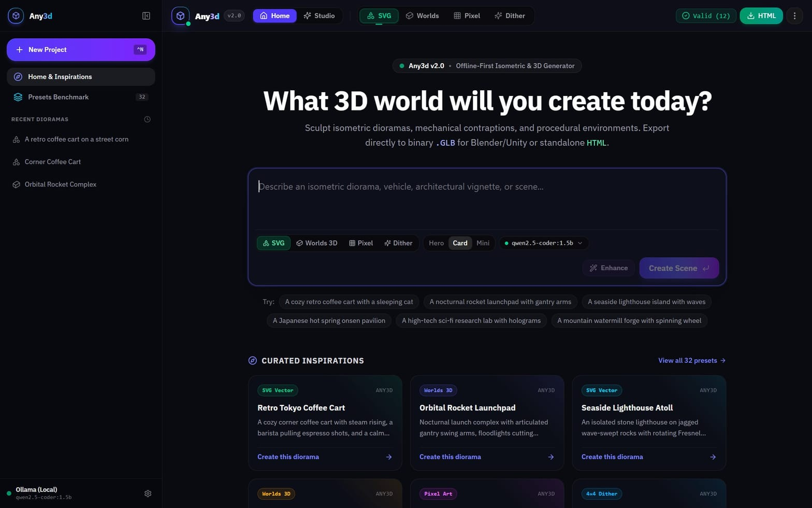
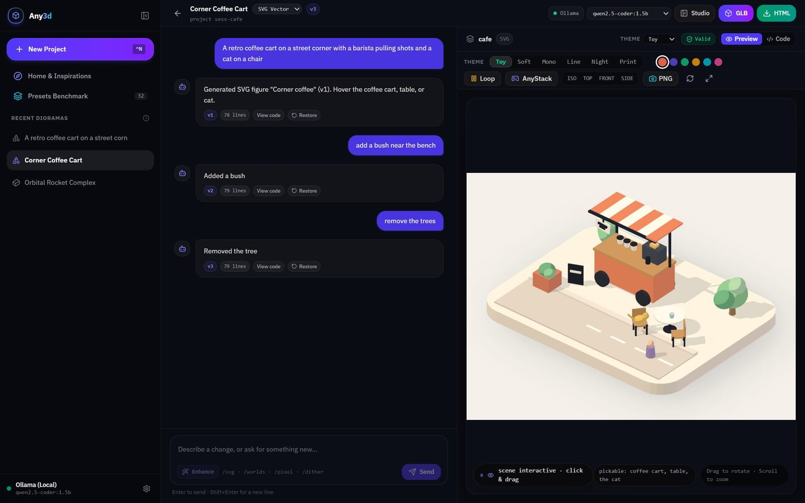
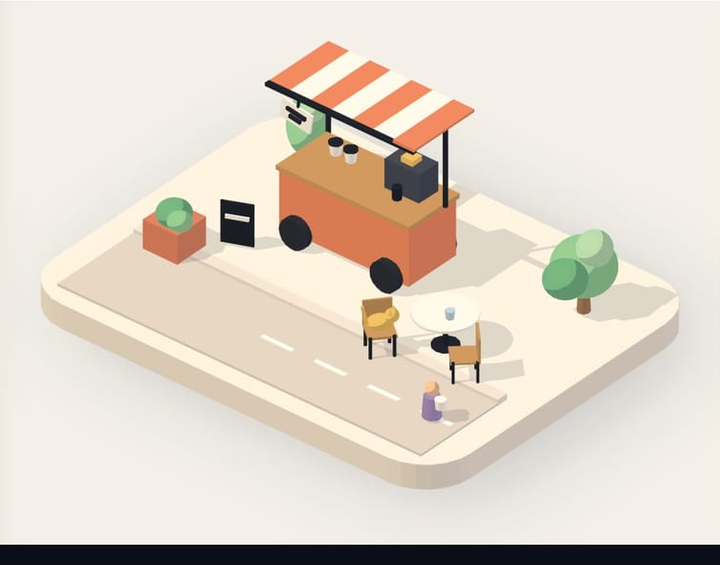
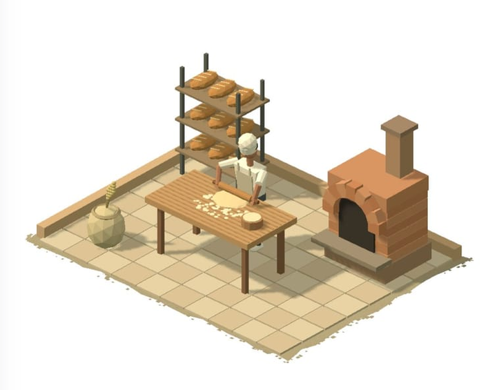
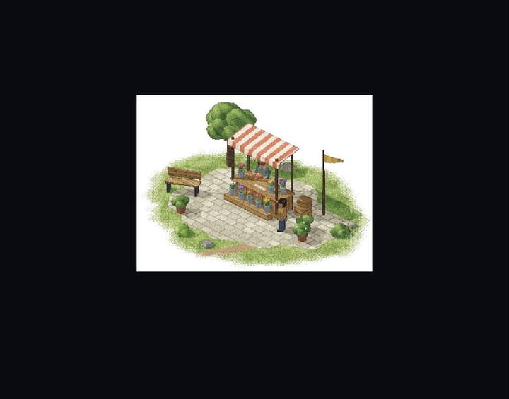
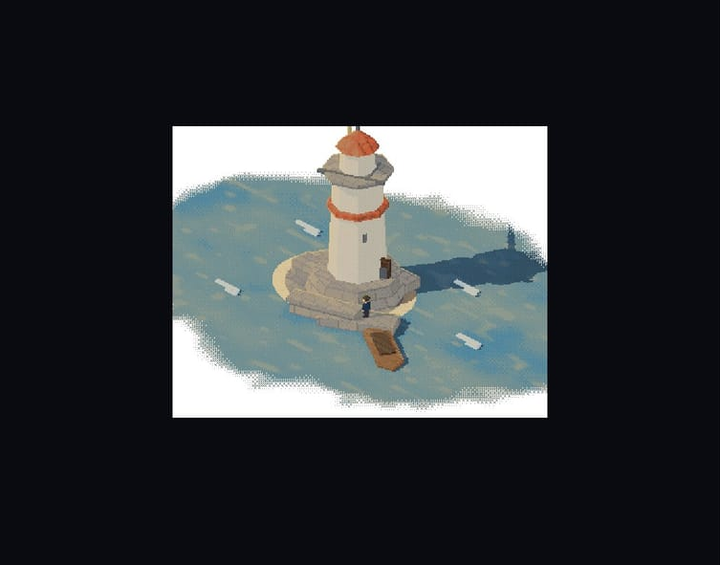
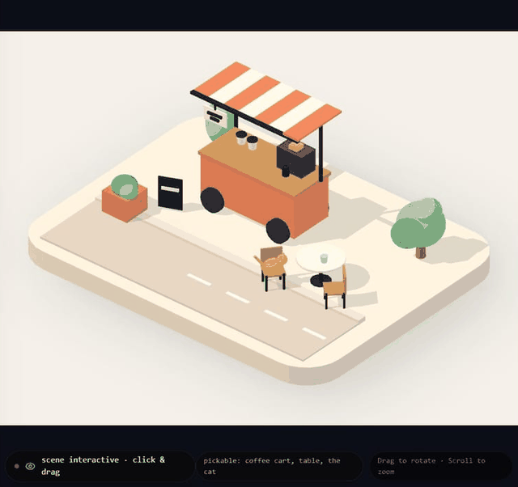
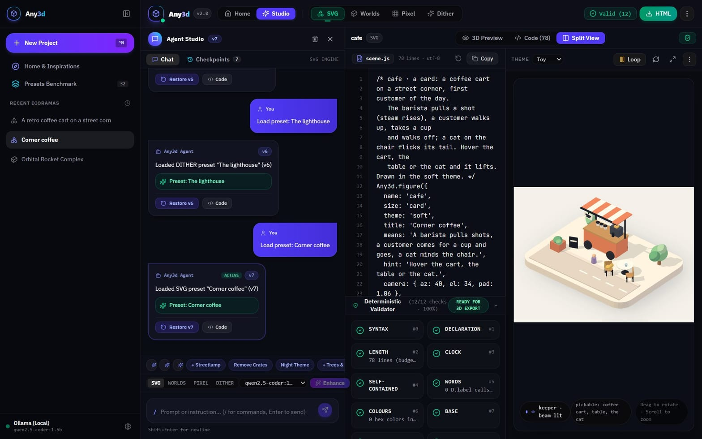
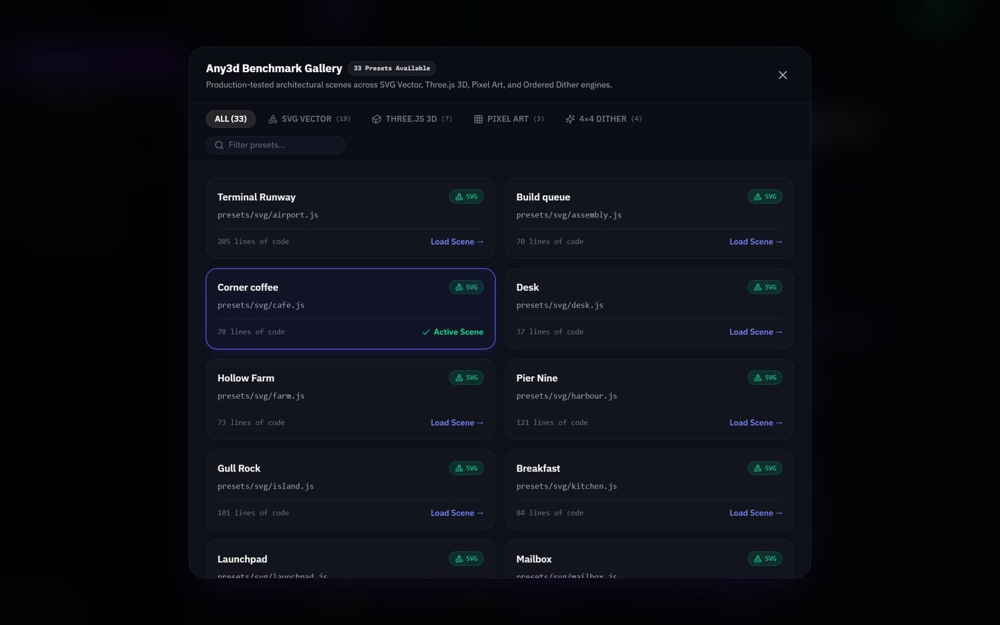
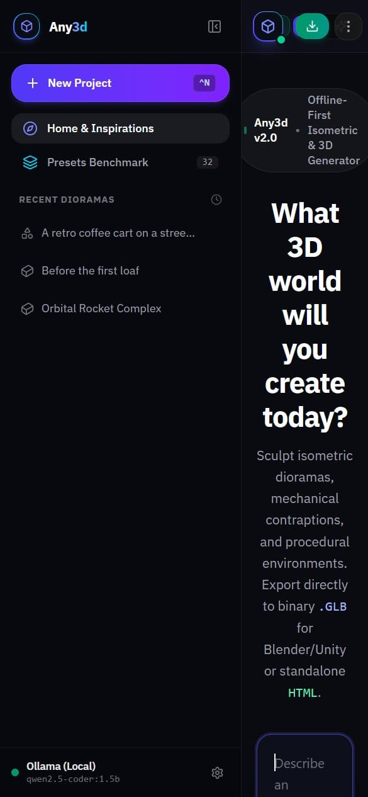

<div align="center">

# Any3d — AI 3D scene generator that runs on your machine

**Describe a scene in plain English. Watch it build itself. Keep editing it in the same chat. Export one HTML file that works offline.**

Local-first · Ollama or Google Gemini · 4 render engines · 6 live themes · 44 preset scenes

[Quick start](#quick-start) · [Engines](#four-render-engines) · [Chat editing](#editing-in-chat) · [Prompt cookbook](#prompt-cookbook) · [Docs](#documentation)

</div>



Any3d is a local-first **text-to-3D scene studio**. It turns a sentence into an interactive, animated 3D scene and keeps it editable through a normal chat: ask for a tree, a night sky, a different awning — the scene changes, the conversation stays. Everything renders from generated JavaScript that you can read, edit and export, with no runtime dependencies and no cloud account required.

---

## Contents

- [What you get](#what-you-get)
- [Quick start](#quick-start)
- [Connect a model](#connect-a-model)
- [Four render engines](#four-render-engines)
- [Six live themes](#six-live-themes)
- [Editing in chat](#editing-in-chat)
- [Export](#export)
- [Validation](#validation)
- [Preset library](#preset-library)
- [Prompt cookbook](#prompt-cookbook)
- [Keyboard shortcuts](#keyboard-shortcuts)
- [Project structure](#project-structure)
- [Documentation](#documentation)
- [FAQ and troubleshooting](#faq-and-troubleshooting)
- [License](#license)

---

## What you get

| | |
|---|---|
| **Prompt to scene** | A sentence becomes a complete, animated scene — geometry, palette, lighting, camera and a `tick()` animation loop. |
| **Chat that edits** | Follow-ups change *the scene you are looking at*: add, remove, restyle. Versioned, restorable, never a surprise new project. |
| **Four engines** | Vector isometric SVG, Three.js worlds, pixel art, and 4×4 ordered dither. |
| **Six themes, four finishes** | Swap the whole look live — `toy`, `soft`, `mono`, `line`, `night`, `print`. |
| **Responsive workspace** | Conversation and scene share one project page; the chat overlays the stage on phones, secondary actions collapse into menus, and light/dark themes are one click apart. |
| **Share as a link** | A whole scene fits in a URL (`#/s/…`) — no account, no upload. Recipients open it as their own copy; your project is never touched. |
| **Offline export** | One self-contained `.html` file with the engine inlined. Double-click it on a plane with no internet. |
| **GLB + PNG** | Send the scene to Blender, Unity or Unreal, or grab a high-resolution still. |
| **Local models** | Runs against Ollama on your own GPU/CPU. No key, no quota, no data leaving the machine. |
| **Deterministic validation** | 12 structural checks on SVG scenes (4–5 on the other engines): clock purity, ground base, picking hooks, size limits — with self-healing. |
| **44 presets** | Production scenes for every engine — 30 SVG, 7 Worlds, 3 Pixel, 4 Dither — usable as starting points or prompt references. |

### A project, not a modal

Starting a project opens **its own page** (`#/project/<id>`) with the conversation on the left and the live scene on the right. Reload it, share the URL with yourself, navigate back — the transcript and the scene come with it.



---

## Quick start

**Requirements:** Node.js 18.18+ (20+ recommended), npm. Optional: [Ollama](https://ollama.com) for fully local generation, or a Google Gemini API key.

```bash
npm install
npm run dev
```

| Service | URL |
|---|---|
| Web UI | http://localhost:5173 |
| API server | http://localhost:3001 |

Production build:

```bash
npm run build     # bundles the client into dist/
npm start         # serves dist/ + the API from port 3001
```

Then open the app, type a scene, and press **Enter**. No account, no sign-up.

---

## Connect a model

Any3d talks to a model to *generate* scenes and to *edit* them. Two providers, switchable at any time from the header (or the `⋮` menu on narrower screens).

### Ollama — fully local

```bash
ollama serve
ollama pull qwen2.5-coder:1.5b
```

Any3d detects installed models automatically. Open the model dropdown in a project's toolbar to pick a bigger model (a 7B coder model improves complex edits).

### Google Gemini — fastest, highest quality

Header → `⋮` → **Add API key** → paste a key from [Google AI Studio](https://aistudio.google.com/app/apikey). The key is stored in your browser's `localStorage` and sent only to the local API server.

> Scenes and transcripts never leave your machine except as model prompts to the provider you selected.

---

## Four render engines

Every engine writes real JavaScript against a small scene API, so what you export is readable source — not a binary blob.

| Engine | Look | Output |
|---|---|---|
| **SVG Vector** | Flat isometric blocks, four-light shading, projected shadows | Inline SVG + CSS animation |
| **Three.js Worlds** | Narrative miniature worlds with articulated characters (2-bone IK) and GLSL post-processing | WebGL, bundled Three.js |
| **Pixel** | 320×240 pixel-art micro-scenes | Canvas raster |
| **Dither** | 4×4 Bayer ordered-dither retro scenes | Canvas raster |

### SVG Vector

Crisp, printable, tiny. Hover-picking gives every prop a name, so the scene is inspectable, not just pretty.



```text
A retro coffee cart on a street corner with a barista pulling shots and a cat on a chair
```

### Three.js Worlds

Denser, warmer, animated. Rendered with an orthographic camera and a post-processing finish.



```text
A morning bakery with a baker rolling dough on a flour-dusted bench
```

### Pixel



```text
A flower stall on wet cobblestone with buckets of tulips and an awning
```

### Dither



```text
A solitary cliffside lighthouse in storm winds with a revolving beam
```

Switch engines any time with `/svg`, `/worlds`, `/pixel` or `/dither` in the chat — the next message is generated in that engine.

---

## Six live themes

Themes repaint an existing SVG scene instantly — no regeneration, no model call.



| Theme | Character |
|---|---|
| `toy` | Pastel blocks, playful contrast |
| `soft` | Warm cream paper, gentle shadows |
| `mono` | Ink tints on white |
| `line` | Hairline ink sketch with a hand-drawn wobble |
| `night` | Dusk palette with glowing lamps and lit windows |
| `print` | Three flat tones per solid, screen-print feel |

Worlds scenes get four **finishes** instead: `miniature`, `pixel`, `halftone`, `blueprint`.

---

## Editing in chat

A project chat behaves like a chat: **the default is always an edit of what is on screen.** A new generation only happens when you ask for one ("start over", "a new scene"), and even then it stays in the same project.

| You type | What happens | Kind |
|---|---|---|
| `make it night time` | Repaints the theme | Instant, no model |
| `add a tree near the cart` | Injects a prop, re-renders | Instant, no model |
| `remove the trees` | Deletes the prop calls | Instant, no model |
| `move the bench left` / `make the cart bigger` | Nudges or scales the named object | Instant, no model |
| `make the car do a lap when I hover it` | Adds a motion loop and a hover reaction | Instant, no model |
| `add a bicycle leaning on the wall` | Model rewrites the scene | Model edit |
| `make the awning red` | Model recolours that object | Model edit |
| `start over: a harbour at dawn` | New generation, same project | New scene |

Every applied edit becomes a **version** with a line count, a `Restore` button and a `View code` shortcut. Failed edits say so plainly instead of silently returning the same scene. The instant path is deterministic and currently SVG-only; on the Worlds, Pixel and Dither engines those requests go to the model.

<details>
<summary>How the edit pipeline works</summary>

1. A deterministic editor runs first: add/remove, move/scale, motion loops, hover reactions and theme shifts are applied without any model call.
2. The chat decides *edit* vs *new scene* (explicit phrasing only for the latter).
3. With Gemini, the model returns the complete updated scene, which is validated before it is accepted.
4. With a local model, Any3d asks for a compact JSON **edit plan** (add/remove/theme + coordinates) and applies it deterministically — a full-scene rewrite is too slow on CPU.
5. Whatever the path, the result must be valid **and** different from the input, otherwise nothing is written and the reply says what failed.

</details>

---

## Export

| Action | Result |
|---|---|
| **HTML** | Single self-contained file: markup, styles, engine and scene inlined. Runs offline, from `file://`, with zero dependencies. |
| **GLB** | Binary glTF for Blender, Unity, Unreal or Three.js. |
| **PNG** | High-resolution snapshot of the current frame. |

The HTML export is the product: hand someone a file, not a deployment.

### Embed a scene

A working local demo lives at [`docs/embed/demo.html`](docs/embed/demo.html) (scene: `docs/embed/scene.html`). Host the exported scene HTML and `public/embed.js` on a site, then add one script tag:

```html
<script
  src="https://your-site.example/embed.js"
  data-src="https://your-site.example/scenes/my-scene.html"
  data-title="My Any3d scene"
  data-ratio="4 / 3"
></script>
```

The loader creates a responsive, lazy iframe, sandboxes it to `allow-scripts` (a bundle needs no same-origin access), and respects the viewer's reduced-motion preference. The exported scene can also be embedded directly from a local HTML file.

---

## Validation

Every SVG scene is checked against 12 deterministic rules — clock purity, length limits, ground base, picking hooks, prop coverage — before it reaches the canvas. The Worlds, Pixel and Dither engines run their own 4–5 engine-specific checks. If a change would break a previously working scene, it is discarded and the reply says so, rather than shipping a blank canvas.



---

## Preset library

44 production scenes across all four engines: 30 SVG, 7 Worlds, 3 Pixel and 4 Dither. Browse them from `⋮` → **Presets** (or `Ctrl/⌘ K`), then use one as a starting point or as a prompt reference for your own. The SVG set includes a barbershop, gym, laundromat, library, arcade, classroom, food truck, greenhouse, campsite and patisserie alongside the harbour, lighthouse and coffee-cart originals.



---

## Prompt cookbook

Short, concrete prompts work best. Name the subject, then the setting, then what is happening.

### Vector / isometric (SVG)

```text
A busy container harbour quay with a gantry crane lifting cargo
A seaside lighthouse island with breathing waves and a docking boat
An airport terminal with planes taxiing and a rotating radar tower
A night-time rocket launchpad with floodlights and swinging gantry arms
A corner bookshop with a cat sleeping in the window
A farmers market stall stacked with crates of produce
```

### Three.js worlds

```text
A florist arranging vibrant bouquets before closing time
A potter drawing hands slowly up a spinning clay vessel
A street juggler performing a three-ball cascade in rhythm
A basketball court at dusk with one player still shooting
```

### Pixel art

```text
An old wooden fishing pier with drying nets and a gull on a bollard
A peaceful riverside allotment with raised vegetable patches and a shed
A rainy neon noodle stall with steam rising from the pot
```

### Dither / retro

```text
A weathered mountain forge with a water wheel turning and glowing embers
A traditional hillside tea house with bamboo railings and a gravel garden
A windmill on a ridge line with turning sails and long shadows
```

### Edit prompts (send them in an existing project)

```text
make it night time
add a streetlamp by the cart
remove the trees
give the whole scene a line-art look
add a bush under the tree
make the awning red
start over: a harbour at dawn
```

---

## Keyboard shortcuts

| Shortcut | Action |
|---|---|
| `Ctrl/⌘ N` | New project (opens a blank project page) |
| `Ctrl/⌘ K` | Preset gallery |
| `Ctrl/⌘ J` | Toggle the chat panel |
| `Ctrl/⌘ I` | Toggle the validation inspector |
| `Ctrl/⌘ B` | Toggle the sidebar |
| `Enter` / `Shift + Enter` | Send / new line in the composer |

---

## Project structure

```text
src/
  components/     ProjectPage, Header, SandboxPreview, ConversationPanel, CodeEditor…
  lib/            api client, hash router, GLB exporter
server/
  engine/         procedural scene kit, validator, bundler, fidelity checker
  llm/            generation, offline + model edits, prompt enhancement
  presets/        svg · worlds · pixel · dither scene sources
docs/
  assets/         screenshots used by this README
  guides/         engine authoring guides
```

**Stack:** React 19 · Vite 6 · Tailwind CSS 4 · Express · esbuild · Three.js · Google Generative AI SDK.

**API surface:** `POST /api/generate`, `POST /api/chat-mutate`, `POST /api/enhance-prompt`, `POST /api/validate`, `POST /api/bundle`, `GET /api/presets`, `GET /api/ollama/models`.

---

## Documentation

- [SVG craft](docs/guides/svg-craft.md) · [SVG motion](docs/guides/svg-motion.md) · [SVG + React](docs/guides/svg-react.md)
- [Worlds scene API](docs/guides/worlds-scene-api.md) · [Worlds art direction](docs/guides/worlds-art-direction.md)
- [Pixel scene API](docs/guides/pixel-scene-api.md) · [Pixel art direction](docs/guides/pixel-art-direction.md)
- [Dither yard](docs/guides/dither-yard.md)
- [Scene payload format](docs/guides/scene-payload.md)
- [Turntable clip export](docs/guides/turntable-export.md) · [Atmosphere and look](docs/guides/atmosphere-and-look.md)
- [Version diff, seed lock, Ask](docs/guides/version-diff-and-seeds.md)
- [Embed snippet and storyboard](docs/guides/embed-and-storyboard.md)
- [Image → palette](docs/guides/palette-from-photo.md)
- [Roadmap](docs/ROADMAP.md) — what ships next and in what order

---

## FAQ and troubleshooting

**Does it need the internet?** No. With Ollama everything — generation, editing, preview, export — runs locally. Gemini is optional.

**Where is my work stored?** Projects and transcripts live in your browser: `localStorage` keys `any3d_saved_sessions` and `any3d_chat_history`. The API key is stored locally too.

**Why does an edit reply say it couldn't apply my change?** Offline editing handles add/remove (props, trees, lamps, people, vehicles, benches), move/scale, motion loops (spin, bob, sway, pulse, orbit), hover reactions and theme shifts in SVG scenes. Recolouring a specific object, new object types, or edits on the Worlds/Pixel/Dither engines need a model: switch to Gemini, or pick a larger local model in the project toolbar.

**A generation seems to hang.** Local CPU inference is slow on first load — the model has to be paged in. Watch the terminal running `npm run dev`; the API logs the model it is using.

**Port already in use?** `npm run dev:client` and `npm run dev:server` can be started separately; set `PORT` for the API.

**Can I use it on a phone?** Yes, the project page stacks into a single column.



---

## License

No `LICENSE` file is included yet. Add one (MIT or Apache-2.0 are the usual choices) before distributing or accepting contributions.
# Any3d

